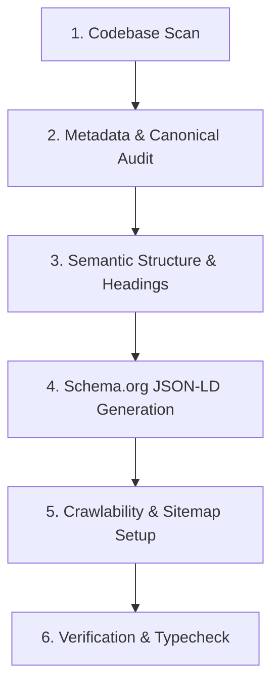

# All-in-One SEO Engine (`/seo`)

The universal SEO skill for end-to-end site analysis, technical audits, structured data generation, and hands-on codebase SEO optimization.

---

## ⚡ Quick Slash Commands & Triggers

When invoked via `/seo`, `/` search action, or natural language prompts like *"seo krni hai project ki"*:

| Command / Intent | Action Executed |
| :--- | :--- |
| **`/seo`** or **`seo krni hai project ki`** | **Full Automated Project Optimization**: Scans codebase, audits metadata, headings, schema, sitemaps, and applies direct high-impact SEO fixes. |
| **`/seo audit <url>`** | Comprehensive external or local site audit covering crawlability, indexability, speed, schema, and mobile. |
| **`/seo technical`** | Deep technical check: `robots.txt`, canonicals, redirect chains, CSP, crawl budgets, and Core Web Vitals (LCP, INP, CLS). |
| **`/seo schema`** | Audits, validates, and generates JSON-LD structured data (`WebSite`, `SoftwareApplication`, `FAQPage`, `BreadcrumbList`, etc.). |
| **`/seo content`** | Audits E-E-A-T, heading structure (strict single H1 rule), keyword prominence, reading level, and image alt text. |
| **`/seo geo`** | Generative Engine Optimization (GEO/AEO): Prepares site for Google AI Overviews, ChatGPT Search, Perplexity, and generates `llms.txt`. |
| **`/seo sitemap`** | Discovers, validates, and generates dynamic XML sitemaps adhering to search engine limits. |
| **`/seo competitor <url>`** | Competitor gap analysis: compares headings, keywords, meta tags, and content depth against competitors. |

---

## 🛠️ Automated Execution Workflow: "SEO Krni Hai Project Ki"

When the user requests project SEO optimization, execute the following 6-step action plan automatically:

### Step 1: Framework & Codebase Inspection
1. Detect project type (e.g., Next.js 14/15 App Router, Pages Router, Vite, Astro, HTML/JS).
2. Locate existing SEO files:
   - Root metadata (`app/layout.tsx` or `pages/_document.tsx`)
   - Robots policy (`app/robots.ts` or `public/robots.txt`)
   - Sitemap (`app/sitemap.ts` or `public/sitemap.xml`)
   - Structured data components (`components/seo/*`, JSON-LD scripts)

### Step 2: Metadata & OpenGraph Optimization
1. **Title Tag**: Primary keyword near the start, brand at end, natural and concise (50–60 characters).
2. **Meta Description**: Compelling CTA, target search intent, 130–160 characters. Avoid keyword stuffing.
3. **Canonical URL**: Dynamic canonical resolution targeting the canonical production domain (avoid hardcoded localhost or preview URLs).
4. **Social Sharing**: OpenGraph (`og:title`, `og:description`, `og:image`, `og:url`) and Twitter Card (`summary_large_image`).

### Step 3: Semantic Headings & Content Quality
1. **Strict Single H1 Rule**: Ensure each page has exactly ONE meaningful `<h1>` tag containing the primary topic keyword.
2. **Heading Hierarchy**: Maintain logical hierarchy (`h1` → `h2` → `h3`) with zero skips.
3. **Image Alt Text**: Audit all `` and Next.js `<Image>` tags. Every image must have descriptive, keyword-relevant alt text (no generic "image" or empty alts on informative images).
4. **Compactness & UX**: Ensure SEO copy (e.g., FAQs, explanatory text) does not push primary gameplay, CTAs, or interactive cards below the fold.

### Step 4: Schema.org Structured Data (JSON-LD)
1. Add structured data scripts using `<script type="application/ld+json">`.
2. Core types to implement where appropriate:
   - **`WebSite`**: With `SearchAction` or site metadata.
   - **`SoftwareApplication`** / **`WebApplication`**: For interactive web apps, games, and SaaS tools (with `applicationCategory`, `operatingSystem`).
   - **`FAQPage`**: Useful Q&A pairs (note: does not guarantee rich snippets, but aids AI engine comprehension).
   - **`Organization`** / **`Brand`**: Name, logo, social profiles.
3. **Invariants**: Do not invent fake ratings, fake review counts, or nonexistent corporate entities.

### Step 5: Robots, Indexing & Privacy Boundaries
1. Ensure the public homepage and shareable public landing pages are indexable (`index, follow`).
2. Private player results, temporary session states, protected creator previews, and PIN-protected management pages MUST include `<meta name="robots" content="noindex, follow" />` or server headers.
3. Configure `robots.ts` to allow search engines (`Googlebot`, `Bingbot`) and AI search agents (`OAI-SearchBot`, `Claude-SearchBot`, `PerplexityBot`) while protecting sensitive admin/api routes.

### Step 6: Automated Verification & Reporting
1. Run local build and typecheck (`npm run typecheck`, `npm run build` or framework equivalent).
2. Output a concise markdown report detailing:
   - Files created or updated
   - Specific keywords and tags targeted
   - Structured data schemas added
   - Verification and build status

---

## 📚 Specialist Reference Manuals

Deep technical guidelines and checklists are located in the [references/](./references/) folder:
- [Technical SEO Audit Guide](./references/technical.md)
- [Schema.org JSON-LD Specifications](./references/schema.md)
- [Content Quality & E-E-A-T Guide](./references/content-eeat.md)
- [Generative Engine Optimization (GEO & AI Overviews)](./references/geo-ai-overviews.md)
- [XML Sitemap Discovery & Best Practices](./references/sitemap.md)
- [Image SEO & Alt Text Optimization](./references/images.md)
- [Keyword Research & Clustering](./references/keyword-research.md)
- [Competitor SEO Analysis](./references/competitor-analysis.md)

---

## 🐍 Built-in Python Helpers

The skill includes pre-configured automation scripts in [scripts/](./scripts/):
- `parse_html.py`: Extract meta tags, headings, schema, and links from any HTML page.
- `schema_generate.py`: Generate and validate Schema.org JSON-LD payloads.
- `sitemap_discovery.py`: Discover and validate XML sitemaps.
- `content_quality.py`: Evaluate text readability, word count, and keyword prominence.
- `pagespeed_check.py`: Quick performance check for Core Web Vitals.
- `agentic_check.py`: Audit page readability for AI search engines and agents.
