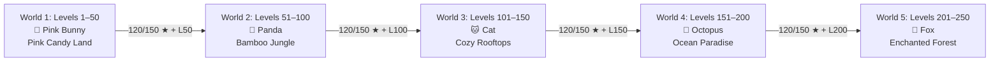

# Jelloo Phase 1: Code Inspection & Implementation Plan (Corrected)

**Document Path:** `docs/jelloo/character-worlds/phase-1-inspection.md`  
**Date:** 27 October 2026 (Updated with verified corrections)  
**Status:** Complete — Inspection & Planning Only  
**Scope:** Character-based, 250-level Adventure Structure (Focus on Architecture & World 1 Roadmap)  
**Author:** Antigravity Pairing Assistant  

---

## Executive Summary

This report delivers a comprehensive code inspection of the local **PlayNudge / Jelloo** engine and formulates an actionable implementation plan for transitioning from the legacy 100-level (5 worlds × 20 levels) structure to the approved **5 Character Worlds (5 worlds × 50 levels = 250 Adventure levels)**.



> [!IMPORTANT]
> **Strict Phase 1 Boundaries Maintained:**
> - Zero gameplay or visual code changes were executed.
> - All baseline automated tests were executed and verified [TESTED]:
>   - On verified Jelloo release commit `d5c7762`: **345 tests total: 340 passed, 0 failed, 5 skipped** (Supabase opt-in tests).
>   - On working Downloads checkout `b025dc9`: **350 tests total: 345 passed, 0 failed, 5 skipped**.
> - All uncommitted changes in working trees are preserved untouched.
> - Production databases (Supabase), ad networks, and the Friendship Quiz remain isolated.

---

## 1. Verified Current Architecture & Relevant Files

| File / Component | Role in Current Engine | Verified Findings & Constraints | Verification Label |
| :--- | :--- | :--- | :--- |
| [`lib/jelloo/worlds.ts`](file:///C:/Users/Fahad%20Saleem/.codex/worktrees/jelloo-victory-release/Couple%20quiz/lib/jelloo/worlds.ts) | World metadata, level-to-world mapping, milestone rewards | Currently defines 5 worlds of 20 levels each (`meadow`, `beach`, `snow`, `candy`, `space`). Hardcodes `worldForLevel(id)` with modulo cycling at level 101+. `milestoneRewardFor` gives awards at 10, 20, 30, 40, 60, 70, 80, 90, 100. | [CODE] [TESTED] |
| [`lib/jelloo/levels.ts`](file:///C:/Users/Fahad%20Saleem/.codex/worktrees/jelloo-victory-release/Couple%20quiz/lib/jelloo/levels.ts) & [`tutorials.json`](file:///C:/Users/Fahad%20Saleem/.codex/worktrees/jelloo-victory-release/Couple%20quiz/data/jelloo/tutorials.json) | Handcrafted tutorial levels (1–10) | Static specifications for Levels 1–10. Board size is 4×4 for Levels 1–4, 5×5 for Levels 5–10. All have single-path solutions with golden star collectibles. | [CODE] [TESTED] |
| [`lib/jelloo/endless.ts`](file:///C:/Users/Fahad%20Saleem/.codex/worktrees/jelloo-victory-release/Couple%20quiz/lib/jelloo/endless.ts) | Level generator router (`levelAt`), single-pal generator (`generatePuzzle`) | Delegates level dispatch by level ID: tutorial (1–10), multi-jelly (71–80, 91–100), power puzzle (odd levels 11–49), or standard procedural puzzle. Uses PRNG seeded by `(seed ^ imul(id, constant))`. | [CODE] [TESTED] |
| [`lib/jelloo/engine.ts`](file:///C:/Users/Fahad%20Saleem/.codex/worktrees/jelloo-victory-release/Couple%20quiz/lib/jelloo/engine.ts) | Core simulation, path tracing, state reducer | Evaluates path connectivity (`tracePath`), rotation logic (`gameReducer`), terrain hazards (`gap`, `cracked`, `wall`, `water`, `slow`, `switch`, `slippery`), and move limit enforcement. | [CODE] [TESTED] |
| [`lib/jelloo/power-generator.ts`](file:///C:/Users/Fahad%20Saleem/.codex/worktrees/jelloo-victory-release/Couple%20quiz/lib/jelloo/power-generator.ts) | Power-specific puzzle generation | Currently interleaves characters across odd levels based on `characterForLevel(id)`: Bunny (gaps), Panda (cracked tiles/gates), Cat (walls/slow paths), Octopus (water), Fox (branching forks). | [CODE] [TESTED] |
| [`lib/jelloo/power-solver.ts`](file:///C:/Users/Fahad%20Saleem/.codex/worktrees/jelloo-victory-release/Couple%20quiz/lib/jelloo/power-solver.ts) | Deterministic solver & necessity auditor | `solvePowerLevel` finds shortest and all-star paths; `auditPowerLevel` verifies that the puzzle is strictly unsolvable without the designated Pal power. | [CODE] [TESTED] |
| [`lib/jelloo/multi-jelly.ts`](file:///C:/Users/Fahad%20Saleem/.codex/worktrees/jelloo-victory-release/Couple%20quiz/lib/jelloo/multi-jelly.ts) | Simultaneous Multi-Pal routing & collision detection | Simulates simultaneous movements; detects same-cell collisions and head-on swaps. Currently hardcoded to Levels 71–80 (2-jelly) and 91–100 (3-jelly). | [CODE] [TESTED] |
| [`lib/jelloo/progress.ts`](file:///C:/Users/Fahad%20Saleem/.codex/worktrees/jelloo-victory-release/Couple%20quiz/lib/jelloo/progress.ts) | Save encoding, decoding, validation | Saves under key `jelloo.progress.v1`. Validates board consistency against `levelAt(s.id, s.seed, rules, multiRevision)`. Hardcodes `id <= 100` as Adventure and bounds Endless `best` entries to 200. | [CODE] [TESTED] |
| [`lib/jelloo/saved-progress.ts`](file:///C:/Users/Fahad%20Saleem/.codex/worktrees/jelloo-victory-release/Couple%20quiz/lib/jelloo/saved-progress.ts) | Safe read abstraction | Reads localStorage without crashing on corrupted data; surfaces warning states. | [CODE] [TESTED] |
| [`lib/jelloo/pals.ts`](file:///C:/Users/Fahad%20Saleem/.codex/worktrees/jelloo-victory-release/Couple%20quiz/lib/jelloo/pals.ts) | Pal metadata, Favourite Pal, unlock checks | Unlocks hardcoded: Bunny (0), Panda (10), Cat (20), Octopus (30), Fox (40). Holds 3 power trials per Pal. Controls Favourite Pal cosmetic override via `isMechanicallyCompatible`. | [CODE] [TESTED] |
| [`lib/jelloo/scoring.ts`](file:///C:/Users/Fahad%20Saleem/.codex/worktrees/jelloo-victory-release/Couple%20quiz/lib/jelloo/scoring.ts) | Search budget & star ratings | 3 stars: finish within move limit AND collect all stars. 2 stars: finish within limit missing stars. 1 star: finish exceeding move limit. | [CODE] [TESTED] |
| [`lib/jelloo/transfer.ts`](file:///C:/Users/Fahad%20Saleem/.codex/worktrees/jelloo-victory-release/Couple%20quiz/lib/jelloo/transfer.ts) | Cross-device save export/import | Enforces strict validation of all save keys (`SAVE_KEY`, `DAILY_SAVE_KEY`, `ZEN_SAVE_KEY`, `PAL_SAVE_KEY`, `COSMETICS_KEY`). Hardcodes world ID checks against `["meadow", "beach", "snow", "candy", "space"]`. | [CODE] [TESTED] |
| [`lib/jelloo/daily.ts`](file:///C:/Users/Fahad%20Saleem/.codex/worktrees/jelloo-victory-release/Couple%20quiz/lib/jelloo/daily.ts) | Daily challenge puzzle generator | Deterministic UTC date seed. Uses `WorldId` tags and character power rotations across weekdays. Independent of Adventure level IDs. | [CODE] [TESTED] |
| [`lib/jelloo/zen.ts`](file:///C:/Users/Fahad%20Saleem/.codex/worktrees/jelloo-victory-release/Couple%20quiz/lib/jelloo/zen.ts) | Relaxed untimed puzzle generator | Allows selecting unlocked world themes via `isWorldUnlocked(world, completedAdventureLevels)`. | [CODE] [TESTED] |
| [`app/jelloo/map/LevelMap.tsx`](file:///C:/Users/Fahad%20Saleem/.codex/worktrees/jelloo-victory-release/Couple%20quiz/app/jelloo/map/LevelMap.tsx) | Adventure Map UI | Hardcoded for 100 levels (5 sections of 20). Checks only `completed >= world.unlockLevel`. Has no star gate gating UI. | [CODE] [TESTED] |
| [`app/jelloo/CharacterSprite.tsx`](file:///C:/Users/Fahad%20Saleem/.codex/worktrees/jelloo-victory-release/Couple%20quiz/app/jelloo/CharacterSprite.tsx) | Character visuals | Uses the approved character image texture through layered CSS elements (`.openEyes`, `.closedEyes`, `.earLayer` mapped to `/jelly-pals/bunny-blink-reference-v1.png`). Other pals rendered via atlas sprite background offsets. | [CODE] [TESTED] |
| [`app/jelloo/game.module.css`](file:///C:/Users/Fahad%20Saleem/.codex/worktrees/jelloo-victory-release/Couple%20quiz/app/jelloo/game.module.css) | Styling, theming & animations | Defines per-world themes via `[data-world="..."]` attributes. | [CODE] [TESTED] |

---

## 2. Existing Changes That Must Be Preserved

Git inspection verified checkouts and uncommitted states:
- **Verified Jelloo release commit:** `d5c7762fc61c64f79c34ea9e5b33617066d4d105` in `C:/Users/Fahad Saleem/.codex/worktrees/jelloo-victory-release/Couple quiz`.
- **Downloads checkout:** Branch `main` (`b025dc9`), containing advertising/SEO commits and 11 uncommitted modified files. These are preserved intact without resets or discards.

---

## 3. Requirement-to-Code Impact Table

| Approved Requirement | Current Code Reality | Required Architectural Change | Engine Impacted Files |
| :--- | :--- | :--- | :--- |
| **5 Worlds × 50 Levels = 250 Levels** | 5 Worlds × 20 Levels = 100 Levels | Redefine `worlds` array: 5 worlds with `startLevel` and `endLevel` spanning 1–50, 51–100, 101–150, 151–200, 201–250. Update Endless continuation to start at 251. | [`worlds.ts`](file:///C:/Users/Fahad%20Saleem/.codex/worktrees/jelloo-victory-release/Couple%20quiz/lib/jelloo/worlds.ts), [`LevelMap.tsx`](file:///C:/Users/Fahad%20Saleem/.codex/worktrees/jelloo-victory-release/Couple%20quiz/app/jelloo/map/LevelMap.tsx), [`progress.ts`](file:///C:/Users/Fahad%20Saleem/.codex/worktrees/jelloo-victory-release/Couple%20quiz/lib/jelloo/progress.ts) |
| **Character-Dedicated Worlds** | Worlds have mixed characters (Bunny, Panda, Cat, Octopus, Fox spread across Meadow, Beach, Snow, Candy, Space) | Associate each world strictly with its mascot: World 1 = Bunny, World 2 = Panda, World 3 = Cat, World 4 = Octopus, World 5 = Fox. | [`worlds.ts`](file:///C:/Users/Fahad%20Saleem/.codex/worktrees/jelloo-victory-release/Couple%20quiz/lib/jelloo/worlds.ts), [`power-generator.ts`](file:///C:/Users/Fahad%20Saleem/.codex/worktrees/jelloo-victory-release/Couple%20quiz/lib/jelloo/power-generator.ts), [`endless.ts`](file:///C:/Users/Fahad%20Saleem/.codex/worktrees/jelloo-victory-release/Couple%20quiz/lib/jelloo/endless.ts) |
| **Character Unlock Conditions** | Unlocked at levels 0, 10, 20, 30, 40 by simple completion | Unlocked only after completing the previous character's world finale (Level 50, 100, 150, 200) AND earning ≥ 120/150 stars in that world. | [`pals.ts`](file:///C:/Users/Fahad%20Saleem/.codex/worktrees/jelloo-victory-release/Couple%20quiz/lib/jelloo/pals.ts), [`worlds.ts`](file:///C:/Users/Fahad%20Saleem/.codex/worktrees/jelloo-victory-release/Couple%20quiz/lib/jelloo/worlds.ts), [`LevelMap.tsx`](file:///C:/Users/Fahad%20Saleem/.codex/worktrees/jelloo-victory-release/Couple%20quiz/app/jelloo/map/LevelMap.tsx) |
| **Star Gates within Worlds** | No star gates exist (pure linear completion lock: `id <= completed + 1`) | Introduce gate validation: Level 10 (15★), Level 20 (36★), Level 30 (60★), Level 40 (84★), Level 50 (110★). Block navigation if stars in preceding world levels < gate requirement. | [`progress.ts`](file:///C:/Users/Fahad%20Saleem/.codex/worktrees/jelloo-victory-release/Couple%20quiz/lib/jelloo/progress.ts), [`LevelMap.tsx`](file:///C:/Users/Fahad%20Saleem/.codex/worktrees/jelloo-victory-release/Couple%20quiz/app/jelloo/map/LevelMap.tsx), [`GameView.tsx`](file:///C:/Users/Fahad%20Saleem/.codex/worktrees/jelloo-victory-release/Couple%20quiz/app/jelloo/GameView.tsx) |
| **Star Gate: Next World Unlock** | Next world unlocks solely by reaching level 20, 40, 60, 80 | Next world unlocks only when World Level 50 is beaten AND the player holds ≥ 120/150 stars in that specific world. | [`worlds.ts`](file:///C:/Users/Fahad%20Saleem/.codex/worktrees/jelloo-victory-release/Couple%20quiz/lib/jelloo/worlds.ts), [`LevelMap.tsx`](file:///C:/Users/Fahad%20Saleem/.codex/worktrees/jelloo-victory-release/Couple%20quiz/app/jelloo/map/LevelMap.tsx) |
| **World Colors, Paths & Scenery** | Themes are Meadow, Beach, Snow, Candy, Space | Theme World 1 as Pink Candy Land (pink roads, frosting, strawberry cottage), World 2 Bamboo Jungle, World 3 Cozy Rooftops, World 4 Ocean Paradise, World 5 Enchanted Forest. | [`worlds.ts`](file:///C:/Users/Fahad%20Saleem/.codex/worktrees/jelloo-victory-release/Couple%20quiz/lib/jelloo/worlds.ts), [`game.module.css`](file:///C:/Users/Fahad%20Saleem/.codex/worktrees/jelloo-victory-release/Couple%20quiz/app/jelloo/game.module.css) |
| **Save File Compatibility** | Saves store `id`, `seed`, `rules`, `multiRevision`, `best` | `decodeJourney` rejects boards if generator creates different tiles/jellies. A campaign version flag must separate Campaign v1 (100 levels) from Campaign v2 (250 levels). | [`progress.ts`](file:///C:/Users/Fahad%20Saleem/.codex/worktrees/jelloo-victory-release/Couple%20quiz/lib/jelloo/progress.ts), [`transfer.ts`](file:///C:/Users/Fahad%20Saleem/.codex/worktrees/jelloo-victory-release/Couple%20quiz/lib/jelloo/transfer.ts) |

---

## 4. Save & Campaign Migration Recommendation

### Why Silent In-Place Reinterpretation Fails [CODE]
1. **Reconstruction Mismatch:** In [`lib/jelloo/progress.ts`](file:///C:/Users/Fahad%20Saleem/.codex/worktrees/jelloo-victory-release/Couple%20quiz/lib/jelloo/progress.ts), `decodeJourney` parses save data and immediately validates it against `initialGame(levelAt(s.id, s.seed, rules, multiRevision))`.
   - If a player saved mid-level at Level 21 in Campaign v1, Level 21 was Beach World (4×4 single-pal). In Campaign v2, Level 21 is a 5×5 Pink Candy Land puzzle.
   - If tile counts, kind distribution, or jelly specifications differ, `decodeJourney` safely returns `null`, treating the reinterpreted save as corrupted.
2. **Hardcoded Adventure Bounds:** In `progress.ts` line 32 and 65:
   ```ts
   ...entries.filter(([id]) => Number(id) <= 100),
   ...entries.filter(([id]) => Number(id) > 100).sort(...).slice(0, 200),
   ```
   And `decodeJourney` rejects saves if `Object.keys(best).filter(id => Number(id) > 100).length > 200`.
   With 250 Adventure levels, saves with progress above level 100 would be misclassified as Endless records and rejected.

### Recommended Versioned Migration Strategy [CODE]
1. **Keep Existing Key Intact:** `jelloo.progress.v1` is preserved byte-for-byte.
2. **Dedicated Versioned Storage:** New Character Worlds campaign saves reside in a distinct namespace (e.g., `jelloo.campaign.v2`), leaving legacy saves unmutated.
3. **No Automatic Switch:** Starting Campaign v2 must be an explicit player action; never trigger an automatic rewrite upon startup.

---

## 5. Asset Inventory: Available vs. Missing

- **Approved Mascots:** Source texture in `public/jelly-pals/approved-reference.png` and `pals-atlas-reference-v1.png`.
- **Bunny Visual Representation:** `CharacterSprite.tsx` renders Bunny using the approved texture (`public/jelly-pals/bunny-blink-reference-v1.png`) mapped through CSS layers (`.openEyes`, `.closedEyes`, `.earLayer`).
- **Concept Reference Art:** `docs/jelloo/character-worlds/jelloo-character-worlds-reference-v2.png` illustrates the 5 environment themes, homes, and Bunny emotional poses.
- **Production Kits Needed for World 1:** Pink Candy Land tile art/color tokens and Strawberry Cottage asset.

---

## 6. Solver Feasibility & Game Balancing Analysis

### Bunny Gap Jump Invariant [CODE]
Source check in [`lib/jelloo/engine.ts`](file:///C:/Users/Fahad%20Saleem/.codex/worktrees/jelloo-victory-release/Couple%20quiz/lib/jelloo/engine.ts#L120-L123) and [`lib/jelloo/power-solver.ts`](file:///C:/Users/Fahad%20Saleem/.codex/worktrees/jelloo-victory-release/Couple%20quiz/lib/jelloo/power-solver.ts#L61-L64):
```ts
if (oriented[next].terrain === "gap") {
  if (character !== "bunny" || jumpUsed) continue;
  next = neighbour(next, exit, level.size); jumpUsed = true;
}
```
**Strict invariant:** Bunny can use **EXACTLY ONE** gap jump per run (`jumpUsed: true`). The generator must never attempt to place multiple required gap leaps in a single run.

### Proposed Rotation Bands & Board Geometry [CODE] [TESTED]
- **Mathematical Feasibility:** A 5×5 board is **not** mathematically capped below 27 moves. As verified in actual engine execution, `levelAt(64, 42)` generates a 5×5 board with a solver par of **31 moves**.
- **Design & Ergonomics Concern:** While mathematically possible, requiring 27–32 manual clicks on a 5×5 grid raises click-fatigue and cognitive engagement concerns. Late-world puzzles must prioritize spatial reasoning and deceptive branching over repetitive rotation counts. Human playtesting will evaluate whether high rotation counts feel satisfying or tedious.

### Star Gate Arithmetic & Deadlock Analysis [CODE]
- Star gate formula:
  - Level 10: 15 stars / 27 max (55.6%)
  - Level 20: 36 stars / 57 max (63.2%)
  - Level 30: 60 stars / 87 max (69.0%)
  - Level 40: 84 stars / 117 max (71.8%)
  - Level 50: 110 stars / 147 max (74.8%)
  - Next World Unlock: Level 50 beaten AND ≥ 120 / 150 stars (80.0%)
- **Arithmetic Verification:** 120 stars across 50 levels is cleanly achievable by various distributions, for example **20 three-star levels (60★) and 30 two-star levels (60★)**, totaling 120 stars.
- **Deadlock Free:** Because replays improve best scores without spending or losing stars, progression deadlock is impossible as long as all levels are solvable and 3-star targets are attainable.

---

## 7. Concrete Scope for FIRST World Only: Pink Candy Land (Levels 1–50)

- **Mascot:** Pink Bunny (`bunny`)
- **Mechanics:** Path alignment, golden stars, and exactly one Bunny gap leap per run.
- **Environment:** Pink Candy Land with strawberry cottage home and pink candy path styling.

---

## 8. Acceptance Tests & Proposed Next Phase

- **Solver Target:** Verify all 50 levels are solvable within reasonable computational limits (to be measured and benchmarked during test runs).
- **Quality Gates:** 100% passing tests across TypeScript typecheck, ESLint, and production build.
