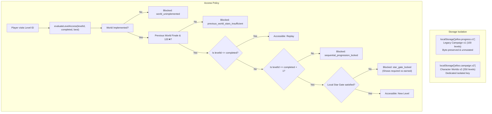

# Jelloo Phase 2: Safe Campaign Foundation & Star-Gate Rules

**Document Path:** `docs/jelloo/character-worlds/phase-2-foundation.md`  
**Date:** 27 October 2026  
**Status:** Complete & Hardened in Phase 2.1 — All 5 Foundation Defects Corrected & Verified (See `phase-2-1-corrections.md`)  
**Author:** Antigravity Pairing Assistant  

---

## 1. Verified Repository, Branch & HEAD Confirmation

Following the Phase 2 mission to ensure safe isolation from unrelated advertising/SEO experiments and uncommitted changes:

| Target | Verified State | Action Taken |
| :--- | :--- | :--- |
| **`Documents/jellypals`** | Not a Git checkout (single image file). | Confirmed non-repository. No code implementation placed here. |
| **`Downloads/Couple quiz`** | Branch `main` (`b025dc9`). Ahead by 7 commits with Adsterra/SEO history; 11 uncommitted modified files in working tree. | Strictly preserved untouched. No reset, no checkout, no discards. |
| **`jelloo-victory-release`** (`C:/Users/Fahad Saleem/.codex/worktrees/jelloo-victory-release/Couple quiz`) | Isolated worktree on release commit `d5c7762fc61c64f79c34ea9e5b33617066d4d105` (`fix(jelloo): diversify late puzzles and refresh victory celebration`). Free of ad network and SEO modifications. | **Selected as the verified development checkout.** Created isolated local branch: `feature/character-worlds-phase2`. |

### Exact Git State Before Editing
- **Checkout Path:** `C:/Users/Fahad Saleem/.codex/worktrees/jelloo-victory-release/Couple quiz`
- **Initial Branch:** `codex/jelloo-victory-release`
- **New Development Branch:** `feature/character-worlds-phase2`
- **Base Commit HEAD:** `d5c7762fc61c64f79c34ea9e5b33617066d4d105`
- **Initial Working Tree:** Clean (4 untracked release logs). Zero uncommitted changes discarded.

---

## 2. Corrected Phase 1 Report Findings

The Phase 1 inspection report has been updated in place across all doc mirrors with the following verified source-referenced corrections:

1. **Bunny Gap Jump Invariant:**  
   *Correction:* In [`lib/jelloo/engine.ts`](file:///C:/Users/Fahad%20Saleem/.codex/worktrees/jelloo-victory-release/Couple%20quiz/lib/jelloo/engine.ts#L120-L123) and [`lib/jelloo/power-solver.ts`](file:///C:/Users/Fahad%20Saleem/.codex/worktrees/jelloo-victory-release/Couple%20quiz/lib/jelloo/power-solver.ts#L61-L64), `jumpUsed` is a boolean flag (`jumpUsed: true`). Bunny can use **EXACTLY ONE** gap jump per run. The engine does not permit two jumps per run; any design requiring double gap jumps violates core engine rules.
2. **5×5 Board Par & Move Bounds:**  
   *Correction:* A 5×5 board is **not** mathematically capped below 27 moves. As verified in actual engine execution, `levelAt(64, 42)` generates a 5×5 board with solver par of **31 moves**. Late-puzzle rotation targets (27–32) represent a player click-fatigue and cognitive engagement concern that must be evaluated via human playtesting, rather than an engine impossibility.
3. **CharacterSprite Visual Rendering:**  
   *Correction:* [`app/jelloo/CharacterSprite.tsx`](file:///C:/Users/Fahad%20Saleem/.codex/worktrees/jelloo-victory-release/Couple%20quiz/app/jelloo/CharacterSprite.tsx) does not render Bunny as a replacement CSS illustration. It renders Bunny using the approved image texture (`/jelly-pals/bunny-blink-reference-v1.png`) mapped through layered CSS elements (`.openEyes`, `.closedEyes`, `.earLayer`).
4. **Exact Test Totals:**  
   *Correction:* The baseline test suite on release commit `d5c7762` comprises **345 tests total: 340 passed, 0 failed, 5 skipped** (Supabase opt-in tests). (In the Downloads checkout, 350 tests total: 345 passed, 0 failed, 5 skipped).
5. **Solver Timing Feasibility:**  
   *Correction:* The "<25ms per level" solver runtime is a proposed performance budget/target to benchmark during generator test runs, not a previously proven metric.
6. **Star Arithmetic:**  
   *Correction:* 120 stars across 50 levels is achievable by combinations such as **20 three-star levels (60★) and 30 two-star levels (60★)**, totaling 120 stars.

---

## 3. Exact Files Created & Changed

All changes are local to the isolated branch `feature/character-worlds-phase2` in `C:/Users/Fahad Saleem/.codex/worktrees/jelloo-victory-release/Couple quiz`:

1. [`lib/jelloo/campaign.ts`](file:///C:/Users/Fahad%20Saleem/.codex/worktrees/jelloo-victory-release/Couple%20quiz/lib/jelloo/campaign.ts) *(New)*:
   - Campaign v2 definitions: 5 worlds × 50 levels = 250 levels with semantic IDs (`candy_land`, `bamboo_jungle`, `cozy_rooftops`, `ocean_paradise`, `enchanted_forest`) and mascots (`bunny`, `panda`, `cat`, `octopus`, `fox`).
   - World availability tracking: World 1 is `"available"`; Worlds 2–5 are `"planned"`.
   - Pure progression functions: `worldForCampaignLevel`, `toLocalLevel`, `toGlobalLevel`, `getEarnedStarsForWorld`, `getEarnedStarsBeforeLocalLevel`.
   - Star-gate access evaluation: `evaluateWorldAccess`, `evaluateLevelAccess`.
   - Result recorder: `recordLevelResult` (score improvement, no duplicate stars, never lowering scores).
2. [`lib/jelloo/campaign-save.ts`](file:///C:/Users/Fahad%20Saleem/.codex/worktrees/jelloo-victory-release/Couple%20quiz/lib/jelloo/campaign-save.ts) *(New)*:
   - Separate storage namespace: `CAMPAIGN_V2_SAVE_KEY = "jelloo.campaign.v2"`.
   - Schema validation: `validateCampaignV2Schema` (version 2, bounds 1–250, best stars 1–3).
   - Safe readers & transactional writers: `readCampaignV2Save`, `readLegacySaveBytes`, `writeCampaignV2Save`.
   - Safe initializer: `initializeCampaignV2` (conflict protection, corruption preservation, zero automatic startup execution).
3. [`tests/jelloo-campaign-v2.test.ts`](file:///C:/Users/Fahad%20Saleem/.codex/worktrees/jelloo-victory-release/Couple%20quiz/tests/jelloo-campaign-v2.test.ts) *(New)*:
   - 10 automated test suites verifying all boundaries, star-gates, bypass protections, score invariants, and storage error recoveries.
4. [`docs/jelloo/character-worlds/phase-1-inspection.md`](file:///C:/Users/Fahad%20Saleem/.codex/worktrees/jelloo-victory-release/Couple%20quiz/docs/jelloo/character-worlds/phase-1-inspection.md) *(Updated)*:
   - Corrected Phase 1 inspection report with source references.
5. [`docs/jelloo/character-worlds/phase-2-foundation.md`](file:///C:/Users/Fahad%20Saleem/.codex/worktrees/jelloo-victory-release/Couple%20quiz/docs/jelloo/character-worlds/phase-2-foundation.md) *(New)*:
   - This phase deliverable.

---

## 4. Campaign & Save Architecture



### Save Schema (`CharacterWorldsSave`)
```ts
export interface CharacterWorldsSave {
  version: 2;
  campaignId: "character_worlds_v2";
  completed: number;       // 0 to 250
  currentLevelId: number;  // 1 to 250
  best: Record<string, number>; // levelId -> stars (1..3)
  motion: boolean;
  muted: boolean;
  createdAt: string;
  updatedAt: string;
  inProgressBoard?: {
    levelId: number;
    moves: number;
    rotations: number[];
  };
}
```

### Export / Import Evolution Strategy
1. **Unified Export:** Future export progress will serialize both `jelloo.progress.v1` and `jelloo.campaign.v2` into the transfer bundle under `saves`.
2. **Backward Compatibility:** Older exports with only `jelloo.progress.v1` will continue to restore into legacy storage without throwing or corrupting data.
3. **Conflict Detection:** Transfer import preview validates both keys independently. If a collision is found in Campaign v2 progress, it surfaces the conflict to the player before any overwrite occurs.
4. **Board Validation Boundary:** In-progress board validation is reserved for Phase 3 when the procedural generator is implemented. In Phase 2, `campaign-save.ts` bounds-checks metadata and isolates board states safely.

---

## 5. Star-Gate Rules & Test Evidence

### World-Local Star Gate Matrix
| Local Gate | Global Level Range (World 1) | Stars Required | Maximum Possible | Percent Required | Status |
| :--- | :--- | :--- | :--- | :--- | :--- |
| **Level 10** | Preceding Levels 1–9 | 15 stars | 27 stars | 55.6% | Verified [TESTED] |
| **Level 20** | Preceding Levels 1–19 | 36 stars | 57 stars | 63.2% | Verified [TESTED] |
| **Level 30** | Preceding Levels 1–29 | 60 stars | 87 stars | 69.0% | Verified [TESTED] |
| **Level 40** | Preceding Levels 1–39 | 84 stars | 117 stars | 71.8% | Verified [TESTED] |
| **Level 50** | Preceding Levels 1–49 | 110 stars | 147 stars | 74.8% | Verified [TESTED] |
| **Next World** | World 1 Levels 1–50 | 120 stars + L50 beaten | 150 stars | 80.0% | Verified [TESTED] |

### Key Test Evidence (`tests/jelloo-campaign-v2.test.ts`)
- **Below, Exact, and Above Thresholds:**
  - Gate 10: 14 stars -> locked; 15 stars -> accessible; 16 stars -> accessible.
  - Gate 20: 35 stars -> locked; 36 stars -> accessible; 37 stars -> accessible.
  - Gate 30: 59 stars -> locked; 60 stars -> accessible; 61 stars -> accessible.
  - Gate 40: 83 stars -> locked; 84 stars -> accessible; 85 stars -> accessible.
  - Gate 50: 109 stars -> locked; 110 stars -> accessible; 111 stars -> accessible.
- **Bypass Protection:** Direct URL access to Level 12 (with `completed: 5`) is blocked with `sequential_progression_locked`. Attempting to access Level 10 with tampered completed but insufficient stars is blocked with `star_gate_locked`.
- **Replay Invariant:** When Gate 10 is locked, Levels 1–9 remain accessible for replay. Replaying with fewer stars does not degrade the record; replaying with more stars updates `best` without duplicating completion rewards.
- **World Unlock Distinction:** 119 stars + Level 50 completed -> locked (`previous_world_stars_insufficient`). 120 stars + Level 49 completed -> locked (`previous_world_incomplete`). 120 stars + Level 50 completed -> reports `eligible_but_unimplemented` because World 2 is planned.
- **Save Isolation:** Initializing Campaign v2 leaves `jelloo.progress.v1` byte-identical. Destination saves with corrupted bytes or existing progress refuse overwrites without explicit force. Storage quota errors are caught gracefully.

---

## 6. Exact Quality-Gate Results

All quality gates were executed locally on branch `feature/character-worlds-phase2`:

| Quality Gate | Command | Result | Details |
| :--- | :--- | :--- | :--- |
| **Focused Test** | `node --import ./tests/setup.mjs --import tsx --test "tests/jelloo-campaign-v2.test.ts"` | **PASS** | 10 suites passed, 0 failed, duration 1.21s. |
| **Full Test Suite** | `npm test` | **PASS** | **355 tests total: 350 passed, 0 failed, 5 skipped** (Supabase opt-in tests). |
| **TypeScript** | `npx tsc --noEmit` | **PASS** | 0 type errors. |
| **ESLint** | `npm run lint` | **PASS** | 0 errors, 15 pre-existing warnings in legacy scripts. 0 warnings in new campaign files. |
| **Production Build** | `npm run build` | **PASS** | Compiled successfully in 11.8s. All 22 routes generated statically. |

---

## 7. Remaining Integration Boundaries & What Was Deferred

As required by Phase 2 constraints, the following were intentionally deferred:
1. **World 1 Generator:** No 50-level generator or puzzle solver integration was added.
2. **Gameplay & UI Redesign:** No changes to `GameView.tsx`, `LevelMap.tsx`, or CSS theming.
3. **Legacy Modes:** Zero alterations to Daily Puzzle, Zen Garden, Trials, Multi-Jelly, Quiz, or ads.
4. **Startup Auto-Switch:** The application continues to boot in its standard mode; Campaign v2 is not automatically activated on load.

---

## 8. Proposed Next Implementation Phase: Phase 3 (World 1 Puzzle Generator)

With the campaign definition, star-gate rules, and storage isolation verified and passing:

1. **Procedural Generator for Pink Candy Land (Levels 1–49):**
   - Single-pal path generator parameterized for Candy Land bands (1–10, 11–20, 21–30, 31–40, 41–49).
   - Integrate Bunny gap leap (strictly 1 gap per run).
   - Generate golden star collectible coordinates.
2. **Handcrafted World 1 Finale (Level 50):**
   - Create a signature, non-procedural puzzle requiring Bunny's gap jump to reach the Strawberry Cottage.
3. **Automated Solver Verification Suite:**
   - Run `solvePowerLevel` on all 50 generated levels to verify 100% solvability and par move accuracy.
4. **Generator Revision & In-Progress Board Integration:**
   - Connect the validated board generator to Campaign v2 save decoding.
